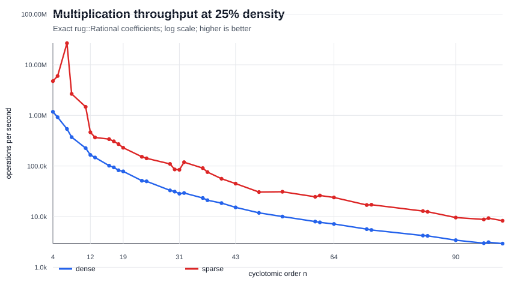
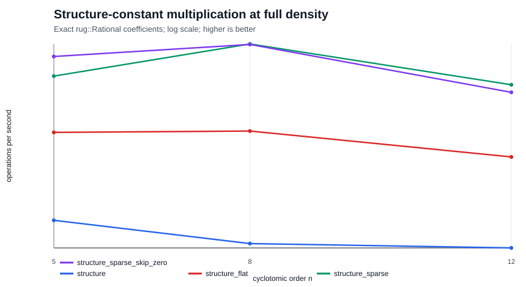
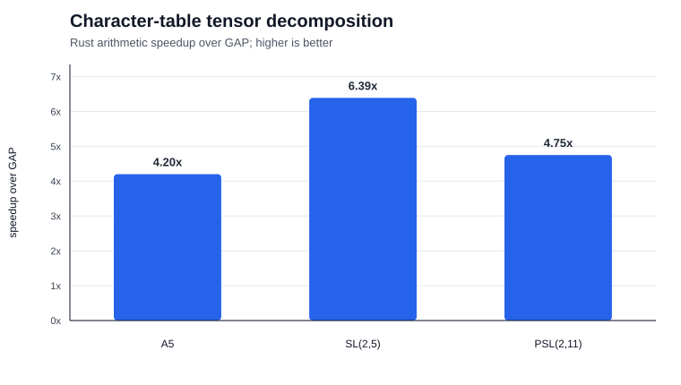

# Cyclotomic

This is a library for exact operations in cyclotomic fields that is
well-tested, well-documented, and aims for speed in certain use
cases. Can be used from C, C++ or Rust.

## TODO

* Get rid of the clones in the Rational implementations.

* See if we can use f64 for cases where we know the answer will be an
  integer.

* See if structure constants can become competitive if we use floats.

* Dense representations:
  - Dense polynomials with computation modulo the cyclotomic
    polynomial

* Get rid of all the copy and paste, make some abstractions that
  actually make sense.

* C FFI interface for calling our Rust code from other languages

* Explicit construction as field of fractions of ring of
  integers. Trivial inversion, good when you're only multiplying?

* More investigation and thought into SIMD usage.

## Why use this library?

There are other libraries for more general use-cases out
there, for example:

* [antic](https://github.com/wbhart/antic)
* [e-antic](https://github.com/videlec/e-antic)
* [Arb](http://arblib.org/)
* [FLINT](http://flintlib.org/)

They all do *many* things and have a wide scope. Our library only does
one thing, and does it *fast*: cyclotomic field operations. And not
just that, we are optimised for the specific use case of cyclotomic
linear algebra, with the intention of using SIMD operations wherever
it will make our code faster (backed up by extensive benchmarking).

There's a lot of structure common to all number fields, and it's
possible to get number field operations reasonably fast. Cyclotomic
fields have additional structure that specialized representations can
exploit. The benchmarks below show where the current implementations
help and where their overheads still dominate.

## Features

* Sparse representations:
  - Using the Zumbroich basis (GAP-inspired) and hash maps of
    exponents (64 bit ints) to coefficients
  - The same as the above, but with arbitrary integer exponents -
    this is for very large degree fields.

* Dense representations:
  - Vector of coefficients and Zumbroich basis (the same as GAP,
    unpacked)
  - Vector of coefficients with multiplication via the structure
    constants (viewed as a Q-algebra).

## Performance

There are two benchmark suites:

1. a 1,074-record sweep over exact dense, sparse, and structure-constant
   arithmetic; and
2. exact character-table workloads checked coefficient-for-coefficient
   against unmodified GAP before timing.

The figures below are from checked-in data. They are indicative single-machine
measurements, not machine-independent guarantees. The core sweep was generated
on arm64 macOS 26.3 on 26 April 2026. Throughput charts use a logarithmic y-axis
and higher is better.

### Core exact arithmetic

The core sweep covers prime, power-of-two, and composite cyclotomic orders up
to 100 at five input densities. Operations use exact `rug::Rational`
coefficients. Dense and sparse timings include the clone/setup cost imposed by
the current mutating API; structure-constant construction is measured
separately from multiplication.

Median multiplication throughput across the sampled orders was:

| input density | dense | sparse | sparse / dense |
| ---: | ---: | ---: | ---: |
| 10% | 30.9k ops/s | 624.5k ops/s | 20.21x |
| 25% | 25.8k ops/s | 84.8k ops/s | 3.28x |
| 50% | 17.5k ops/s | 18.6k ops/s | 1.06x |
| 75% | 12.6k ops/s | 8.1k ops/s | 0.64x |
| 100% | 8.9k ops/s | 4.6k ops/s | 0.51x |

This supports a narrower conclusion than “sparse is always faster”: sparse is
substantially better for genuinely sparse inputs, the crossover in this sample
is near 50% density, and dense wins for mostly full coefficient vectors.



The structure-constant experiments compare the original nested tensor with a
flat tensor, nonzero-only storage, and nonzero-only storage that also skips zero
input coefficients. At full density, the best tested layout improved
multiplication by 2.31x-2.79x:

| order | original nested layout | best tested layout | best throughput | speedup |
| ---: | ---: | --- | ---: | ---: |
| 5 | 170.6k ops/s | sparse, skip zero inputs | 396.4k ops/s | 2.32x |
| 8 | 151.4k ops/s | sparse constants | 422.8k ops/s | 2.79x |
| 12 | 148.1k ops/s | sparse constants | 342.8k ops/s | 2.31x |



The complete core results and additional density/order graphs are in the
[performance notebook](notebooks/performance_benchmarks.ipynb) and
[structure-constant notebook](notebooks/structure_constant_variants.ipynb).

### Character-table arithmetic against GAP

The reference crate imports the exact GAP character tables for `A5`,
`SL(2,5)`, and `PSL(2,11)`. One timed sweep decomposes every unordered pair of
irreducible characters. Before timing, every Rust multiplicity vector is
checked against unmodified GAP.

One indicative run used 15 calibrated samples with a 20 ms target per sample:

| table | GAP | Rust arithmetic | speedup | prepared ring basis lookup | ring vector product |
| --- | ---: | ---: | ---: | ---: | ---: |
| A5 | 3.547 us | 0.844 us | 4.20x | 0.001 us | 0.062 us |
| SL(2,5) | 7.151 us | 1.119 us | 6.39x | 0.001 us | 0.133 us |
| PSL(2,11) | 5.378 us | 1.133 us | 4.75x | 0.001 us | 0.087 us |



The “Rust arithmetic” column prepares imported tables and invariant weighted
conjugates before timing; temporary arithmetic and result construction remain
inside. The GAP timing uses its public libgap operation and native object
representation. Prepared representation-ring timings exclude the one-time ring
construction cost. See the
[reference benchmark documentation](reference/gap-cyclotom/README.md) for the
exact workload, semantic checks, setup/allocation boundaries, and profiling
controls.

### Reproduce the graphs

The core graph pipeline requires only Rust and the Python standard library:

```console
$ cargo run --release --example perf_bench > benchmarks/results/performance.json
$ cargo run --release --example perf_bench -- --quick > benchmarks/results/structure_variants_quick.json
$ python3 benchmarks/render_notebook.py
$ python3 benchmarks/render_structure_variants_notebook.py
$ python3 benchmarks/render_readme_graphs.py
```

To reproduce comparisons with the original GAP kernel, follow the
[libgap build and benchmark instructions](reference/gap-cyclotom/README.md#benchmark).

## Quick start

The core library only needs a Rust toolchain.

### Use cyclotomic in a Rust program

To install the latest release, install
[cargo](https://doc.rust-lang.org/cargo/getting-started/installation.html)
to get a functional Rust installation, including the cargo package
manager. Then add the `cyclotomic` crate to your `Cargo.toml`:

```toml
[dependencies]
cyclotomic = "1.*"
```

If you're using this before version 1 is released, then change that to
"0.*", but there'll be a lot of breaking changes.

### Use cyclotomic in a C or C++ program

TODO, but this is very important.

### More documentation

Take a look
[here](https://cyclotomicfields.github.io/cyclotomic/cyclotomic/) for
full API documentation, along with code examples.

## Quick start for devs

1. Install Rust using the instructions on their
[website](https://www.rust-lang.org/tools/install). On macOS with
Homebrew, you can also run `brew install rust`.
2. Check that Cargo is on your PATH by running `cargo --version` in the
terminal
3. Clone this repository using
`git clone https://github.com/CyclotomicFields/cyclotomic.git`
4. Check that all the tests pass using `cargo test`
5. Add your name to the contributors list in this README and push, to confirm
that you have push permissions
6. Check that your push has triggered a pipeline build on
[Travis](https://travis-ci.com/github/CyclotomicFields/cyclotomic/builds)

## Building the documentation

Just run `cargo doc --no-deps` and have a look at
`target/doc/cyclotomic` with a web browser.

Coming soon: MathJax rendered LaTeX math in the documentation.

## Motivation

Most of the motivation for this project comes from representation
theory. In particular, given a finite group G, where m is the least
common multiple of the orders of the elements of G, let K be a
cyclotomic field containing the mth roots of unity.

Then using only coefficients from K, you can realise all
representations of G. So in some sense, the cyclotomic numbers are
"all you need" when it comes to the representation theory of finite
groups.

The goals of this project are (in order):

1. Implement field operations and equality for cyclotomic fields of
   arbitrary degree. This includes testing, since otherwise we don't
   know whether it works or not.

2. Make it readable, well documented, and not a complete mess to
   contribute to. Documentation may or may not include detailed and
   rigorous (in a mathematical sense) proofs of any
   performance-enhancing tricks used.

3. Profile and benchmark everything so the performance of this library
   is good enough that it can be used to solve non-trivial problems.

## Where this could be useful

The benchmark evidence is currently strongest for repeated exact operations on
character rows and prepared representation rings. The literature suggests the
following application directions. These are opportunity areas, not claims that
the crate already supplies each complete high-level workflow.

* **Finite-group characters, tensor products, and representation growth.**
  Character values lie in cyclotomic fields, while tensor-product
  multiplicities are obtained from weighted character scalar products. This is
  the workload already exercised by the GAP comparison and prepared-ring
  benchmarks. Recent work on
  [growth problems for finite-group representations](https://arxiv.org/abs/2408.04196)
  likewise computes with character tables, tensor products, Galois actions, and
  cyclotomic fields.

* **Torsion units in integral group rings.** The
  [HeLP method](https://arxiv.org/abs/1507.08174) derives constraints using
  ordinary and Brauer characters together with traces from cyclotomic fields.
  Batched exact character arithmetic could accelerate the trace and constraint
  generation stages. A complete integration would still need the planned
  general field-trace and Galois-action APIs.

* **Finite geometry, difference sets, and weighing matrices.** Character
  methods translate group-ring equations into conditions on cyclotomic
  integers. Schmidt's
  [Cyclotomic Integers and Finite Geometry](https://doi.org/10.1090/S0894-0347-99-00298-2)
  applies this viewpoint to difference sets, projective planes, planar
  functions, and group-invariant weighing matrices. This crate could serve as
  the exact arithmetic layer beneath search or nonexistence computations.

* **Exact quantum circuit synthesis.** Clifford-cyclotomic gate sets naturally
  lead to matrices over cyclotomic rings and their localizations; see
  [Forest, Gosset, Kliuchnikov, and McKinnon](https://arxiv.org/abs/1501.04944).
  Exact cyclotomic arithmetic is useful for symbolic circuit equality and
  synthesis prototypes, although a production tool would need APIs for rings
  of integers, localization, matrices, and unitary-specific operations.

* **Modular data and fusion rules.** Galois actions on cyclotomic fields can
  produce modular invariants and fusion-rule automorphisms, as described by
  [Fuchs, Gato-Rivera, Schellekens, and Schweigert](https://arxiv.org/abs/hep-th/9405153).
  The prepared representation-ring work is structurally close to repeated
  fusion-product queries, but general Galois action remains future work.

* **Reference arithmetic for cyclotomic-ring cryptography.** Ring-LWE is built
  from ideal-lattice arithmetic over number rings, prominently cyclotomic
  rings; see
  [Lyubashevsky, Peikert, and Regev](https://doi.org/10.1145/2535925).
  This crate may be useful as a slow exact oracle for tests or small prototypes.
  It is not a production cryptographic backend: it currently targets rational
  exactness rather than constant-time modular arithmetic, NTTs, sampling, or
  side-channel resistance.

## Inspiration

The implementation we have borrowed most from is the one for the
[GAP computer algebra system](https://github.com/gap-system/gap/blob/master/src/cyclotom.c),
which implements specific logic for cyclotomic fields using various
basis tricks. This is closest in spirit to what we're doing, but isn't
standalone.

Another library is
[cyclotomic](https://hackage.haskell.org/package/cyclotomic) which is
the same thing but in Haskell. This is just a reimplementation of
GAP's algorithms, but I find Haskell code easier to read than C
sometimes, so this deserves a mention.

## Benchmark sources

The machine-readable measurements live in
[`benchmarks/results`](benchmarks/results), graph generation lives in
[`benchmarks/render_readme_graphs.py`](benchmarks/render_readme_graphs.py), and
the standalone GAP extraction and comparison suite lives in
[`reference/gap-cyclotom`](reference/gap-cyclotom).

#### Contributors

Rob Moore, Kaashif Hymabaccus

## Copyright

Copyright (C) 2020 Rob Moore, Kaashif Hymabaccus

This program is free software; you can redistribute it and/or modify
it under the terms of the GNU Lesser General Public License as
published by the Free Software Foundation; either version 3 of the
License, or (at your option) any later version.

This program is distributed in the hope that it will be useful, but
WITHOUT ANY WARRANTY; without even the implied warranty of
MERCHANTABILITY or FITNESS FOR A PARTICULAR PURPOSE.  See the GNU
Lesser General Public License for more details.

The full license text can be found in the [LICENSE file](/LICENSE).
